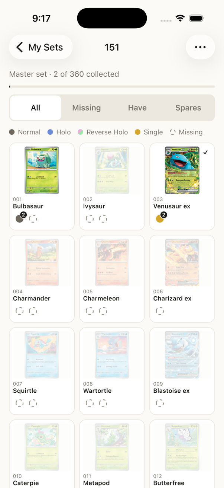

# Master Set Tracker

A free, ad-free mobile app for collectors working on **master sets**: every
card in a set, in every version it was printed in. Open a set, tap what you
have, and see at a glance what's missing and what you have spare.

The design is in
[`docs/superpowers/specs/2026-11-14-master-set-tracker-design.md`](docs/superpowers/specs/2026-11-14-master-set-tracker-design.md).



More screenshots: [`docs/screenshots/plan-2/`](docs/screenshots/plan-2/).

## What's here

A pnpm monorepo (Node 22 or newer):

| Path | What it is |
| --- | --- |
| [`apps/mobile`](apps/mobile/README.md) | The Expo app (iOS, Android, web preview). |
| `packages/catalog-core` | Types for the card catalog: sets, cards, version kinds. |
| `packages/collection-core` | Collection logic shared by every client: counts per version, progress, filters, spares, value, and the SQLite/in-memory store. |
| `tools/catalog` | The catalog builder (`pnpm catalog …`). |
| [`catalog/`](catalog/README.md) | Hand-written rules per set, and the built catalog in `catalog/dist/` that the app bundles. |
| `docs/` | Design, plans and screenshots. |

## Getting started

```sh
pnpm install
```

The repo uses `node-linker=hoisted` (see `.npmrc`) because React Native needs
a flat `node_modules`.

### Run the app

```sh
pnpm --filter mobile ios     # iPhone simulator (needs Xcode)
pnpm --filter mobile start   # Expo Go on your phone: scan the QR code
pnpm --filter mobile web     # browser preview at http://localhost:8081 (doesn't save)
```

Details, including how the catalog gets into the app and why draft sets only
show in development, are in [`apps/mobile/README.md`](apps/mobile/README.md).

### Tests and type checks

```sh
pnpm test        # every package's tests (Vitest for the packages, Jest for the app)
pnpm typecheck   # TypeScript across the catalog tool, collection-core and the app
```

### Build the catalog

```sh
pnpm catalog build <set id>   # e.g. pnpm catalog build sv03.5
pnpm catalog build --all
```

See [`catalog/README.md`](catalog/README.md) for how to read the checklists and
how publishing works.
